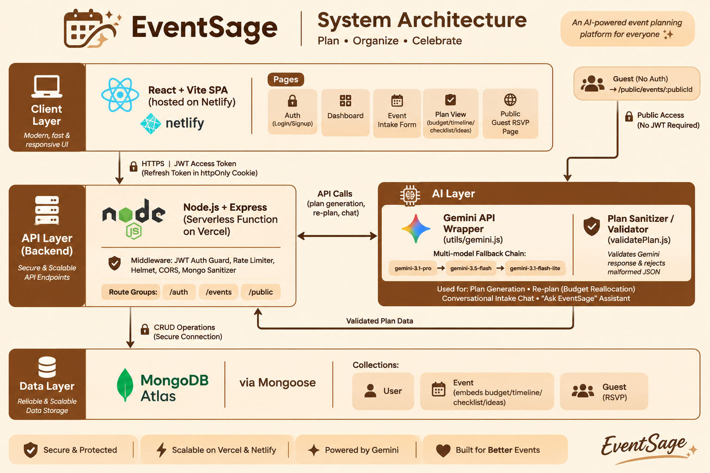

# EventSage — Celebration & Event Planner

Built for **PromptWars Virtual** (Hack2skill, in collaboration with Google for Developers).

## Chosen Vertical

**Celebration & Event Planner** — a GenAI-powered assistant that helps users organize weddings, birthdays, and community events with budgets, timelines, vendor checklists, and personalized ideas.

## Approach & Logic

EventSage turns a short event brief (occasion, date, location, guest count, budget, vibe) into a complete, editable plan in one AI call, then supports an agentic "re-plan" action for when real-world changes happen.

1. **Structured intake, not open chat.** A short form captures the event brief as structured fields, which keeps the AI prompt grounded and the output predictable — this avoids vague, unusable AI responses.
2. **One well-engineered prompt, strict JSON contract.** The backend sends a single Gemini prompt instructing the model to return budget, timeline, checklist, and ideas as a fixed JSON shape. The response is parsed and **sanitized server-side** (`server/src/utils/validatePlan.js`) — any malformed or missing fields are dropped rather than trusted, so a bad AI response never corrupts stored data or breaks the UI.
3. **Multi-model fallback chain.** AI calls walk an ordered list of Gemini models — `gemini-3.1-pro` → `gemini-3.5-flash` → `gemini-3.1-flash-lite` by default — trying the next one on error, timeout, or malformed output (`server/src/utils/gemini.js`). The chain is a single environment variable (`GEMINI_MODEL_CHAIN`, comma-separated) so models can be reordered, added, or swapped without a code change as Google ships newer versions.
4. **Agentic re-planning.** Rather than regenerating the whole plan from scratch, the "Re-plan" action sends only the current budget plus a plain-English description of what changed (e.g. "I lost ₹10,000 on a venue deposit") and asks the model to reallocate the remaining budget — this is the differentiator: context-aware adjustment, not a one-shot generator.
5. **Everything stays editable.** AI output is a starting point, not a locked answer — budget entries, checklist status, and timeline are all persisted to MongoDB and editable from the UI.
6. **Guest-facing surface.** Each event gets a public, unauthenticated RSVP link (`/e/:publicId`) so the tool is useful beyond the organizer.

## How the Solution Works

### Architecture


- **Frontend**: React + Vite, deployed to Netlify. No heavy UI framework — a small hand-written CSS theme (sandal/brown palette) keeps the client bundle and repo size small.
- **Backend**: Node.js + Express, deployed to Vercel as a serverless function (`server/api/index.js`).
- **Database**: MongoDB Atlas via Mongoose (`User`, `Event`, `Guest` collections).
- **AI**: Google Gemini API (`@google/generative-ai`), primary/fallback model wrapper described above.

### Security
**Authentication**
- Passwords hashed with **bcrypt** (cost 12), length-capped to stop oversized-payload hashing; `passwordHash` and `refreshTokenHash` are `select: false` in the schema, so they never leave the DB unless a route opts in.
- **Short-lived access JWT** (15 min) held in memory only (never `localStorage`), limiting exposure to XSS.
- **Refresh token** (7 days) in an **httpOnly, Secure** cookie scoped to `/auth` (`SameSite=None` in production because the frontend and API are on different sites). Only its SHA-256 hash is stored, and it is **rotated atomically** on every use, so a replayed or stolen-and-reused token is rejected.
- JWT verification pins the algorithm (`HS256`), rejecting `alg: none` and algorithm-confusion tokens.
- Login errors are generic for both an unknown email and a wrong password, so the response doesn't reveal which emails are registered.

**Request hardening**
- Every route validates its input with `express-validator` (types, lengths, ObjectId/hex formats). Plan edits from the client go through the same sanitizer as AI output, so neither can store malformed data.
- Ownership checks on every event/guest route; another user's event returns 404, so ids can't be probed.
- Layered rate limits: site-wide (300/15 min), auth (10/15 min), AI (30/15 min) and public RSVP writes (20/15 min), with `trust proxy` set so limits key on the real client IP behind Vercel.
- `helmet` with a strict `default-src 'none'` CSP for the JSON API; CORS restricted to the configured frontend origins.
- `express-mongo-sanitize` strips `$`-operators to prevent NoSQL injection; JSON bodies are capped at 100 KB.
- A central error handler only returns client-safe messages; stack traces and DB errors never reach the client.
- Required environment variables are checked at startup, so a misconfigured deploy fails immediately with a clear error.

### Efficiency
- **Indexes matched to real queries:** `{ownerId, createdAt}` serves the dashboard list with its sort; `{eventId, respondedAt, createdAt}` serves the guest list.
- **`.lean()` and field projections on read paths:** the dashboard omits chat transcripts, and guest routes load only the event's `_id` for their ownership check.
- **Paginated** event list (`?limit=&skip=`, max 100).
- **Atomic single-query updates** (`findOneAndUpdate`) for RSVP, mark-sent and token rotation, replacing read-modify-write round trips.
- `compression` on API responses; short-lived public `Cache-Control` on guest-facing event pages (personalised invite responses are `no-store`).
- **Gemini:** one shared client, plus a per-model timeout in the fallback chain, so a slow model can't stall a request.
- **Serverless DB connection** is created once and shared by concurrent cold-start requests.
- **Frontend:**
  - Route-level code splitting with `React.lazy`, so each page is its own chunk.
  - `jspdf` loads only when a PDF is exported.
  - Memoized derived data.
  - Guest-list polling pauses while the tab is hidden.

### Accessibility
- Semantic landmarks (`<nav>`, `<main>`) and a visible skip-to-content link for keyboard/screen-reader users.
- Each page sets its own document title, and focus moves to `<main>` on navigation so screen readers announce the change.
- Every form input has an associated `<label>` and a `maxLength` matching the server's limit; errors are announced via `role="alert"`, status updates via `role="status"`.
- Guest tables have captions and scoped headers, and action buttons have guest-specific labels ("Remove Priya"). Decorative icons and emoji are hidden from assistive tech.
- All interactive controls are native `<button>`/`<a>` elements, fully keyboard-operable with visible focus outlines.
- Animations respect `prefers-reduced-motion`.
- Palette checked against WCAG AA (≥ 4.5:1) in both light and dark mode.

### Core Features
- Email/password signup & login with secure session handling.
- **Conversational AI intake** — instead of a static form, a chat-style assistant (`POST /events/intake-chat`) asks one follow-up question at a time until it has enough to propose a structured event brief, which the user reviews/edits before the event is created.
- AI-generated plan: budget breakdown, timeline, vendor checklist, theme ideas.
- **AI moodboard** — a theme name, 4-color palette, and short style description generated alongside the plan and rendered as swatches.
- **Smart budget insights** — the model flags risky allocations (e.g. catering too low for the guest count, a missing obvious category) as inline severity-coded chips (info/warning/critical).
- **"Ask EventSage" chat assistant** — a persistent per-event chat panel (`POST /events/:id/chat`) that answers open-ended questions using that event's actual budget/timeline/checklist as context, with history persisted to MongoDB.
- Editable budget and checklist (status cycle: todo → booked → paid), persisted to MongoDB.
- AI re-plan: describe a real-world change, get the budget reallocated.
- Dashboard with event list, stat cards, countdown, and animated budget-used progress bars.
- Public, no-login guest RSVP page per event with a shareable link.
- **Export plan as PDF** — budget, timeline, checklist, and ideas as a downloadable document, with `jspdf` lazy-loaded so it never bloats the initial page load.
- **Confetti celebration** on a "yes" RSVP (skips the animation when the visitor has `prefers-reduced-motion` set).
- **Dark mode** with a toggle in the navbar, persisted per browser, palette re-checked against WCAG AA.
- All AI endpoints are additionally rate-limited (`aiLimiter`, 30 req/15min) on top of the site-wide limits, since they're the most expensive calls the API makes.

### Folder Structure
```
eventPlanner/
  client/        React + Vite frontend (Netlify)
  server/        Express backend (Vercel serverless)
    src/
      models/      Mongoose schemas + indexes
      routes/      auth, events (CRUD), ai, guests, public (RSVP)
      middleware/  JWT auth guard, ownership checks, validation, rate limiters, error handling
      utils/       Gemini wrapper, prompts, plan sanitizer, JWT helpers, constants
    tests/         Jest + Supertest + mongodb-memory-server
  client/src/
    pages/         one lazily-loaded chunk per route
    components/    shared UI (guests/, charts/)
    hooks/         useGuests, usePageTitle
    utils/         pure, unit-tested helpers
  PLAN.md          Full design/build plan
```

## Setup

### Backend
```
cd server
cp .env.example .env   # fill in MongoDB Atlas URI, JWT secrets, Gemini API key
npm install
npm run dev
npm test                # runs the backend test suite
```

### Frontend
```
cd client
cp .env.example .env   # set VITE_API_URL to the backend URL
npm install
npm run dev
```

## Testing

**Backend**: 91 tests in `server/tests/`, using Jest, Supertest and mongodb-memory-server, so no real database or Gemini key is needed. Line coverage is about 99% (`npm run test:coverage`). The suite covers:
- **Auth & sessions:**
  - Signup and login validation.
  - Generic login errors.
  - Refresh-token rotation, with replay rejected.
  - Logout revokes the session.
  - Secrets are excluded from queries.
  - Login is rate-limited.
- **Events:**
  - Validation.
  - Pagination and projection.
  - Isolation between users.
  - Malformed ids return 400.
  - Plan-patch merging and sanitization.
  - Deleting an event also deletes its guests.
- **Guests:**
  - Personal and bulk invites, with dedupe and length checks.
  - Mark-sent happens at most once.
  - Cross-event and cross-user access is blocked.
- **Public RSVP:**
  - Only guest-safe fields are exposed.
  - Cache headers are correct.
  - RSVPing from an invite link updates that guest; RSVPing from the open link creates a new one.
  - Submissions are rate-limited.
- **AI routes** (Gemini mocked):
  - Plan generation, re-plan, chat history capping and the intake brief.
  - A safe 502 when every model fails.
- **Hardening:**
  - Security headers and the CORS allow-list.
  - Malformed JSON returns 400 and oversized bodies return 413.
  - NoSQL-injection payloads are rejected.
  - JWTs signed with a different algorithm are rejected.
  - The error handler never leaks internals.
- **Utilities:** plan sanitizer, Gemini fallback chain, env checks.

**Frontend**: 42 tests in `client/src/**/*.test.{js,jsx}`, using Vitest and React Testing Library. They cover:
- The API client's single-flight token refresh.
- Protected-route redirects.
- Signup and Login forms.
- The public RSVP flow.
- Guest grouping and filtering logic.
- The `useGuests` and `usePageTitle` hooks.
- Guest table rendering.
- Date utilities.

Run with `npm test` inside `server/` or `client/`.

**CI**: `.github/workflows/ci.yml` runs lint, both test suites and the frontend build on every push and PR to `main`.

## Assumptions

- Single-currency budgets; defaults to INR, but all amounts are plain numbers the user can relabel.
- One owner per event — no multi-editor collaboration in this version.
- The guest RSVP link is the access control for guests (no separate guest login); anyone with the link can RSVP.
- AI-suggested budgets, timelines, and vendor lists are a starting point and regional estimate — every value remains user-editable, since real costs vary by location and vendor.

## Deployment

- **Frontend** → Netlify (build command `npm run build`, publish directory `dist`, `_redirects` included for client-side routing).
- **Backend** → Vercel (serverless entry at `server/api/index.js`, routing configured in `server/vercel.json`).
- **Database** → MongoDB Atlas (connection string via `MONGO_URI` env var, never committed).
